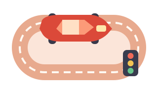

<div align="center">
  <h1>🏁 RaceHub OG</h1>
  <p><strong>Die offene Rennabend-Zentrale für Carrera DIGITAL 132 / 124</strong></p>
  <p>Rennen veranstalten, das Fahrerlager organisieren, die Show steuern und Ergebnisse auswerten — auf dem eigenen Computer.</p>
  <p>
    <a href="https://github.com/DickHorner/RaceHubOS_Dick/actions/workflows/ci.yml"></a>
    <a href="LICENSE"></a>
  </p>
  <p>
    <a href="README.md"><kbd>🇬🇧 English</kbd></a> &nbsp;
    <strong><kbd>🇩🇪 Deutsch</kbd></strong> &nbsp;
    <a href="README.fr.md"><kbd>🇫🇷 Français</kbd></a>
  </p>
  <p>
    <a href="#rennzentrale">Rennen</a> ·
    <a href="#garage-und-fahrerlager">Garage</a> ·
    <a href="#show-und-sound">Show &amp; Sound</a> ·
    <a href="#datenlabor">Datenlabor</a> ·
    <a href="#schnellstart">Schnellstart</a> ·
    <a href="#mitmachen">Mitmachen</a>
  </p>
</div>

RaceHub OG ist eine eigenständige Weiterentwicklung von [RaceHubOS](https://github.com/AnselmeSDR/RaceHubOS). Die browserbasierte Rennzentrale läuft lokal und verbindet sich über Bluetooth LE / AppConnect mit der Carrera Control Unit. Mit dem integrierten Simulator kannst Du die Software auch ohne Rennbahn erkunden. Für den lokalen Betrieb ist kein Cloud-Konto nötig.

| [](#rennzentrale) | [](#garage-und-fahrerlager) |
|:---:|:---:|
| **[Rennzentrale](#rennzentrale)** — Sessions, Meisterschaften, Rennregeln und Rennleitung | **[Garage & Fahrerlager](#garage-und-fahrerlager)** — Autos, Fahrer, Teams und Strecken |
| [](#show-und-sound) | [](#datenlabor) |
| **[Show & Sound](#show-und-sound)** — Touch-Soundpult, Live-Anzeigen und Ansagen | **[Datenlabor](#datenlabor)** — Rundenzeiten, Historie, Statistik und Export |

## Rennzentrale

- Training, Qualifying und Rennen mit Live-Zeitnahme, Rangliste, Startampel, Podium und Ergebnissen.
- Manuelle und automatische Meisterschaften mit Qualifikationsgruppen, Rennfortschritt und Gesamtwertung.
- Rennregeln für Wetter und Trocken-/Regenreifen, virtuellen Kraftstoff samt Nachtanken, Pflichtboxenstopps, Kraftstoffgewichts-Wertung und simulierte Schäden.
- Individuelle Fahrerdisplays und getrennte mobile Rennleitung für Strafen, bestätigte Strafableistung, Boxenentscheidungen und Virtual Safety Car (VSC). Welche Aktionen verfügbar sind, hängt von Sessionstatus, Verbindung und Berechtigung ab.

## Garage und Fahrerlager

- Fahrer, Fahrzeuge, Teams und Strecken mit Bildern, Profilen, Rekorden und Rennhistorie verwalten.
- Technische Fahrzeugdaten hinterlegen und Geschwindigkeits-, Brems- und Tankstufen der Control Unit in zehn Stufen konfigurieren.
- Fahrzeuge in speziellen Balancing-Sessions anhand ihrer Rundenzeiten vergleichen.

## Show und Sound

- Eigenständiges, touchfreundliches Soundpult für die Show-Bedienung, ohne Rennleiterrechte.
- Soundbibliothek mit eigenen Audio-Clips und Sprach-Presets sowie automatischen Ereignis-Sounds (auch für Tank- und Strafereignisse).
- Sprachansagen, optionales lokales Rennambiente mit Absenkung während der Ansagen, persönliche Fahreranzeigen und ein schreibgeschütztes Zuschauer-Scoreboard.
- Die Wiedergabe auf einem anderen Gerät setzt einen empfangsbereiten Browser und die bestehenden Zugriffsbedingungen voraus.

## Datenlabor

- Session- und Meisterschaftshistorie, Rundenzeiten, Rennereignisse, Statistiken und Ranglisten.
- Excel-/CSV-Export relevanter Daten und eine druckbare Ergebnisansicht.
- Optionales **Offline-HTML-Ergebnisblatt** für beendete Rennen/Qualifyings: Vorschau vor dem Download, standardmäßig anonymisierte Fahrerbezeichnungen und Namen nur nach ausdrücklicher Auswahl und Prüfung.

### Hardware und Simulation unterscheiden

| Funktion | Wirkung |
|---|---|
| Wetter- und Reifensimulation | Beeinflusst virtuelle Zeitwertung, **nicht** gemessene Rundenzeiten oder die tatsächliche Fahrzeuggeschwindigkeit. |
| Virtueller Kraftstoff, Boxenstrategie und Tankgewicht | Werden getrennt vom Kraftstoffmodus der Carrera-CU berechnet. |
| VSC sowie Fahrzeuggeschwindigkeit/-bremse | Können Befehle an die **echte Control Unit** senden. Die physische Wirkung muss auf der eigenen Bahn geprüft werden; Simulator und CI sind dafür kein Nachweis. |

## Schnellstart

**Voraussetzungen:** [Node.js ab 22.13](https://nodejs.org/), npm ab 10 und Git. Für echte Rennen zusätzlich eine kompatible Carrera DIGITAL 132/124 Control Unit, AppConnect und einen funktionierenden Bluetooth-LE-Adapter. Der Simulator benötigt keine Carrera-Hardware.

> [!WARNING]
> Die beiliegenden Skripte `RaceHubOS-install-win.bat` und `RaceHubOS-install-mac.command` laden derzeit noch das ursprüngliche Repository `AnselmeSDR/RaceHubOS` herunter, **nicht diesen Fork**. Installiere RaceHub OG deshalb manuell wie unten beschrieben. Auch die Update-Versionsprüfung fragt noch das Ursprungsrepository ab; sie ist kein verlässlicher Updatehinweis für diesen Fork.

<details open>
<summary><strong>🪟 Windows — PowerShell</strong></summary>

Öffne PowerShell nach der Installation von Node.js, npm und Git:

```powershell
git clone https://github.com/DickHorner/RaceHubOS_Dick.git
cd RaceHubOS_Dick
npm install
npm run dev
```

</details>

<details>
<summary><strong>🍎 macOS — Terminal</strong></summary>

```bash
git clone https://github.com/DickHorner/RaceHubOS_Dick.git
cd RaceHubOS_Dick
npm install
npm run dev
```

</details>

<details>
<summary><strong>🐧 Linux — Terminal</strong></summary>

```bash
git clone https://github.com/DickHorner/RaceHubOS_Dick.git
cd RaceHubOS_Dick
npm install
npm run dev
```

Für den echten Bluetooth-Betrieb sind BlueZ und passende System-D-Bus-Berechtigungen erforderlich. Siehe [Linux-Bluetooth](docs/LINUX-BLUETOOTH.md). Starte den Backend-Prozess nicht als root.

</details>

Die Entwicklungsoberfläche erreichst Du unter **http://localhost:5173**, das Backend unter **http://localhost:3001**. Beim Start werden Prisma-Client und Datenbankmigrationen automatisch geprüft beziehungsweise angewendet.

Für eine lokal gebaute Instanz zunächst den Entwicklungsmodus beenden und anschließend starten:

```bash
npm run build
npm start
```

Öffne **http://localhost:3001**. Prüfe vor Updates, dass Dein Git-Remote auf **diesen Fork** zeigt, und sichere die Renndaten. Verlasse Dich nicht auf den noch auf Upstream ausgerichteten Installer oder Versionscheck.

<details>
<summary><strong>Simulator, Geräte im Netzwerk und Rennleiterzugang</strong></summary>

- **Simulator:** Aktiviere in den Einstellungen den Admin-/Entwicklungsmodus, damit der Simulator in der Geräteliste erscheint. Damit prüfst Du Softwareabläufe, nicht die reale Bluetooth-Verbindung.
- **Handys und Bildschirme:** Verwende in einem vertrauenswürdigen lokalen Netzwerk die LAN-Adresse des Renn-PCs. `localhost` auf dem Handy meint das Handy und nicht den Renn-PC.
- **Rennleitung:** Richte den Rennleiter-Zugangscode lokal am Renn-PC ein. Fahrerlinks verleihen keine Rennleiterrechte. Setze die API nicht ungeschützt ins Internet und betrachte den Chaos-Button nicht als sicherheitsgeprüften Not-Aus. Siehe [mobile Rennleitung und Zugriffsgrenzen](docs/MOBILE-RACE-CONTROL.md).

</details>

<details>
<summary><strong>Entwicklung und Prüfungen</strong></summary>

Das Monorepo verwendet React/Vite, Tailwind und Socket.IO in `packages/frontend`, Node/Express und Prisma/SQLite in `packages/backend` sowie gemeinsame Domänenlogik in `packages/shared`.

```bash
npm run check -- --ci
npm run build
npm test -w @racehubos/backend
```

Oberflächentests erfolgen mit Playwright. Maßgeblich sind [CONTRIBUTING.md](CONTRIBUTING.md), die [Repo-Konventionen](docs/CONVENTIONS.md) und die [Architekturübersicht](docs/ARCHITECTURE.md). Backendtests verwenden eine separate Testdatenbank. Ein erfolgreicher Build oder CI-Lauf belegt keine Funktion an der echten Carrera-Hardware.

</details>

## Mitmachen

Fehlerberichte, Ideen, Übersetzungen, UX-Verbesserungen und Codebeiträge sind willkommen. Sieh Dir die [Issues](https://github.com/DickHorner/RaceHubOS_Dick/issues) an, lies [CONTRIBUTING.md](CONTRIBUTING.md) und erstelle gezielte Pull Requests. Offene Hardwarefragen sollten an einer echten CU überprüft und nicht aus Simulatortests abgeleitet werden.

## Lizenz und Herkunft

RaceHub OG steht unter der [GNU Affero General Public License v3 oder neuer](LICENSE) (`AGPL-3.0-or-later`). Hinweise zu Fremdkomponenten stehen in [THIRD_PARTY_NOTICES.md](THIRD_PARTY_NOTICES.md).

**Ursprung:** [RaceHubOS](https://github.com/AnselmeSDR/RaceHubOS) wurde von **Anselme Schneider** gegründet und mit **Romain Danna** als Co-Autor entwickelt. RaceHub OG führt diese Grundlage in diesem Repository weiter. Wichtige Quellen zum Carrera-Protokoll sind [Stephan Hess / slotbaer.de](http://www.slotbaer.de/) sowie [carreralib](https://github.com/tkem/carreralib) und [OpenLap](https://github.com/tkem/openlap) von Thomas Kemmer. Danke an alle Mitwirkenden.

*RaceHub OG ist ein unabhängiges Community-Projekt und kein offizielles Carrera-Produkt.*
