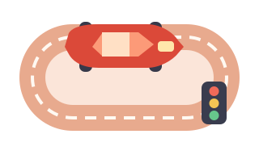

<div align="center">
  <h1>🏁 RaceHub OG</h1>
  <p><strong>The open-source race-night cockpit for Carrera DIGITAL 132 / 124</strong></p>
  <p>Run races, manage the paddock, direct the show, and explore the results — on your own computer.</p>
  <p>
    <a href="https://github.com/DickHorner/RaceHubOS_Dick/actions/workflows/ci.yml"></a>
    <a href="LICENSE"></a>
  </p>
  <p>
    <strong><kbd>🇬🇧 English</kbd></strong> &nbsp;
    <a href="README.de.md"><kbd>🇩🇪 Deutsch</kbd></a> &nbsp;
    <a href="README.fr.md"><kbd>🇫🇷 Français</kbd></a>
  </p>
  <p>
    <a href="#race-control">Racing</a> ·
    <a href="#garage-and-paddock">Garage</a> ·
    <a href="#show-and-sound">Show &amp; Sound</a> ·
    <a href="#data-lab">Analysis</a> ·
    <a href="#getting-started">Get started</a> ·
    <a href="#contributing">Contribute</a>
  </p>
</div>

RaceHub OG is a community continuation of [RaceHubOS](https://github.com/AnselmeSDR/RaceHubOS). It combines a local, browser-based race manager with a Carrera Control Unit connected through Bluetooth LE / AppConnect. The built-in simulator lets you explore the software without a track. No cloud account is required for the local race-night setup.

| [](#race-control) | [](#garage-and-paddock) |
|:---:|:---:|
| **[Race control](#race-control)** — Sessions, championships, race rules and race direction | **[Garage & paddock](#garage-and-paddock)** — Cars, drivers, teams and tracks |
| [](#show-and-sound) | [](#data-lab) |
| **[Show & Sound](#show-and-sound)** — Touch sound pads, live displays and announcements | **[Data lab](#data-lab)** — Lap times, history, statistics and exports |

## Race control

- Practice, qualifying and race sessions, with live timing, a leaderboard, start lights, a podium and session results.
- Manual and automatic championships with qualification groups, race progression and standings.
- Race rules for weather and dry/wet tyres, virtual fuel and refuelling, mandatory pit stops, fuel-weight scoring, and simulated damage.
- Personal driver displays and a separate mobile race director interface for penalties, confirmed penalty serving, pit decisions and Virtual Safety Car (VSC). Available controls depend on the session state, connection and authorization.

## Garage and paddock

- Manage drivers, cars, teams and tracks, with pictures, profiles, records and race history.
- Store detailed car specifications and configure the Control Unit's speed, brake and fuel levels in ten steps.
- Compare car performance using a dedicated balancing session and lap-time statistics.

## Show and sound

- A standalone, touch-friendly soundboard for the show operator, separate from race-director permissions.
- A sound library with uploaded clips and speech presets, plus automatic event-driven cues (including fuel and penalty events).
- Voice announcements, optional local race ambience with speech ducking, personal driver views and a read-only spectator scoreboard.
- Remote sound playback is available only when the destination browser is ready and the existing access requirements are met.

## Data lab

- Session and championship history, lap times, race events, statistics and rankings.
- Excel/CSV exports for relevant data and a printable result view.
- An optional **offline HTML result sheet** for finished race/qualifying sessions: preview before download, anonymous driver labels by default, and names only after explicit selection and review.

### Hardware and simulation are different

| Capability | Effect |
|---|---|
| Weather and tyre simulation | Adjusts virtual timing/scoring; **does not** change measured laps or physical car speed. |
| Virtual fuel, pit strategy and fuel weight | Calculated separately from the Carrera CU's own fuel mode. |
| VSC and car speed/brake settings | Can send commands to the **physical CU**. Verify their effect on your own track; simulated success or passing CI is not hardware proof. |

## Getting started

**Requirements:** [Node.js 22.13+](https://nodejs.org/), npm 10+, Git. For real races, you also need a compatible Carrera DIGITAL 132/124 Control Unit, AppConnect and a working Bluetooth LE adapter. The simulator needs no Carrera hardware.

> [!WARNING]
> The bundled `RaceHubOS-install-win.bat` and `RaceHubOS-install-mac.command` **still download the original `AnselmeSDR/RaceHubOS` repository**, not this fork. Use the manual installation below for RaceHub OG. The in-app version check also queries the original repository, so it is not a reliable update indicator for this fork.

<details open>
<summary><strong>🪟 Windows — PowerShell</strong></summary>

Open PowerShell with Node.js, npm and Git installed:

```powershell
git clone https://github.com/DickHorner/RaceHubOS_Dick.git
cd RaceHubOS_Dick
npm install
npm run dev
```

</details>

<details>
<summary><strong>🍎 macOS — Terminal</strong></summary>

```bash
git clone https://github.com/DickHorner/RaceHubOS_Dick.git
cd RaceHubOS_Dick
npm install
npm run dev
```

</details>

<details>
<summary><strong>🐧 Linux — Terminal</strong></summary>

```bash
git clone https://github.com/DickHorner/RaceHubOS_Dick.git
cd RaceHubOS_Dick
npm install
npm run dev
```

For physical Bluetooth use, Linux relies on BlueZ and system D-Bus permissions. Read [Linux Bluetooth transport](docs/LINUX-BLUETOOTH.md); do not run the backend as root.

</details>

Open **http://localhost:5173** for the development interface. The backend runs on **http://localhost:3001**. The startup script generates the Prisma client and verifies/applies database migrations.

For a local built instance, stop development mode, then run:

```bash
npm run build
npm start
```

Open **http://localhost:3001**. For updates, verify that your Git remote points to **this fork** and back up race data; do not rely on the upstream-facing installer or version check.

<details>
<summary><strong>Simulator, LAN devices and race-director access</strong></summary>

- **Simulator:** enable the admin/developer UI mode in Settings to show the simulator in the device list. This tests software flows, not real Bluetooth behavior.
- **Phones and displays:** connect devices on a trusted LAN using the race PC's LAN address; `localhost` on another device points to that device, not the race PC.
- **Race direction:** initialize the director credential locally on the race PC. Driver links do not grant director privileges. Never expose the API to the public internet or treat a driver's Chaos button as a safety-rated emergency stop. See [mobile race control and access boundaries](docs/MOBILE-RACE-CONTROL.md).

</details>

<details>
<summary><strong>Development and checks</strong></summary>

The monorepo uses React/Vite, Tailwind and Socket.IO in `packages/frontend`, Node/Express and Prisma/SQLite in `packages/backend`, and shared domain logic in `packages/shared`.

```bash
npm run check -- --ci
npm run build
npm test -w @racehubos/backend
```

Browser tests are maintained with Playwright; see [Contributing](CONTRIBUTING.md), [repository conventions](docs/CONVENTIONS.md) and the [architecture overview](docs/ARCHITECTURE.md). Backend tests use a disposable test database. A successful build or CI run does not prove behavior on real Carrera hardware.

</details>

## Contributing

Ideas, bug reports, translations, UX improvements and code contributions are welcome. Check [open issues](https://github.com/DickHorner/RaceHubOS_Dick/issues), read [CONTRIBUTING.md](CONTRIBUTING.md), and propose focused pull requests. Known hardware questions should be reproduced on an actual CU rather than inferred from simulator tests.

## License and credits

Licensed under the [GNU Affero General Public License v3 or later](LICENSE) (`AGPL-3.0-or-later`); see [third-party notices](THIRD_PARTY_NOTICES.md).

**Origins:** [RaceHubOS](https://github.com/AnselmeSDR/RaceHubOS) was created by **Anselme Schneider**, with **Romain Danna** as co-author. RaceHub OG develops that foundation further in this repository. Carrera protocol references include [Stephan Hess / slotbaer.de](http://www.slotbaer.de/), [carreralib](https://github.com/tkem/carreralib) and [OpenLap](https://github.com/tkem/openlap) by Thomas Kemmer. Thanks to all contributors.

*RaceHub OG is an independent community project, not an official Carrera product.*
